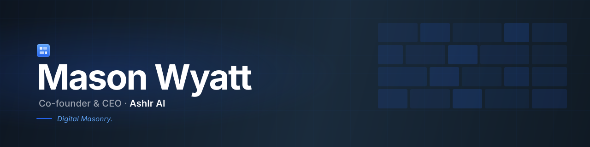

<p align="center">
  
</p>

<h1 align="center">Hi, I'm Mason 👋</h1>

<p align="center">
  Co-founder &amp; CEO at <a href="https://ashlr.ai"><b>Ashlr.AI</b></a>.<br>
  We build software that gives people and AI agents more leverage—starting with <b>Phantom</b>, our open-source engineering workbench.
</p>

<p align="center">
  <a href="https://ashlr.ai"></a>
  <a href="https://github.com/ashlrai"></a>
  <a href="mailto:mason@ashlr.ai"></a>
</p>

<p align="center">
  <a href="https://x.com/masonwyatt23">𝕏</a> ·
  <a href="https://www.linkedin.com/in/mason-wyatt-932400201/">LinkedIn</a> ·
  <a href="https://www.instagram.com/mason.wyatt.23">Instagram</a> ·
  <a href="https://substack.com/@ashlr">Substack</a> ·
  <a href="https://maswy.com">maswy.com</a>
</p>

---

## Phantom is the workbench. The ecosystem is the engineering system.

<a href="https://github.com/ashlrai/phantom"></a>

**[Phantom](https://github.com/ashlrai/phantom)** is our open-source workbench for coding agents and agentic engineering. It brings projects, agent sessions, local models, tools, and guarded fleet workflows into one place—with inspectable work and human control.

Our ambition is bigger than another coding assistant: an engineering system that can take an objective, explore approaches, build and evaluate software, learn from evidence, and improve over time. **That is the direction we are building toward, not a claim that unrestricted autonomy is already shipped.** Resident automation is opt-in, dormant until separately set up and authorized, and currently macOS-only.

```sh
npm install -g @ashlr/phantom
phm --version
phm verse
```

<p>
  <a href="https://github.com/ashlrai/phantom"></a>
  <a href="https://github.com/ashlrai/phantom-secrets"></a>
  <a href="https://verse.ashlr.ai/ecosystem"></a>
</p>

**[Meet Phantom](https://phm.dev)** · [Source](https://github.com/ashlrai/phantom) · [Quickstart](https://github.com/ashlrai/phantom/blob/master/docs/QUICKSTART.md) · [Ecosystem map &amp; dated star history](https://verse.ashlr.ai/ecosystem)

*The 40-star figure is the dated sum of the six core ecosystem repositories—Phantom, Phantom Secrets, Locus, Lexicon, AshlrCode, and Morphkit—not unique people, adoption, or a live counter. Individual badges above update from GitHub.*

## The open-source engineering ecosystem

Each tool can stand on its own. Together, they give the workbench more of the context and safeguards an engineering system needs.

| Project | Part of the system | Repository |
|---|---|---|
| **Phantom** | Autonomous engineering fleet + workbench: shared queues route work across agent accounts, local models, and remote machines; agents collaborate over a bus; merges and releases run themselves. | [ashlrai/phantom](https://github.com/ashlrai/phantom) |
| **Phantom Secrets** | Local vault, proxy, and MCP tools; supported routes keep managed credentials out of agent context. | [phantom-secrets](https://github.com/ashlrai/phantom-secrets) |
| **Locus** | Identity plane that pins an agent session to the intended account and tenant. | [locus](https://github.com/ashlrai/locus) |
| **Lexicon** | Personal vocabulary that corrects speech-to-text names and technical terms before an agent sees them. | [lexicon](https://github.com/ashlrai/lexicon) |
| **AshlrCode** | Multi-provider coding agent for the terminal. | [ashlrcode](https://github.com/ashlrai/ashlrcode) |
| **Morphkit** | Tooling to turn React and TypeScript apps into native SwiftUI projects. | [morphkit](https://github.com/ashlrai/morphkit) |
| **Ashlr Stack** | CLI and MCP tools for provisioning and connecting development services. | [ashlr-stack](https://github.com/ashlrai/ashlr-stack) |
| **Ashlr Plugin** | Compact engineering tools for Claude Code and Codex. | [ashlr-plugin](https://github.com/ashlrai/ashlr-plugin) |
| **BinShield** | Inspect npm install scripts and native binaries in the software supply chain. | [binshield](https://github.com/ashlrai/binshield) |
| **WebFetch** | License-aware image search for tools and agents. | [webfetch](https://github.com/ashlrai/webfetch) |
| **Ashlr MD** | AI-native Markdown app with MCP integration. | [ashlr-md](https://github.com/ashlrai/ashlr-md) |

**[Explore all public Ashlr repositories →](https://github.com/orgs/ashlrai/repositories?type=public)**

## What we're building at Ashlr

Ashlr.AI is a forward-deployed software and AI engineering company. We work with enterprise, government-contractor, and funded product teams to connect critical systems, automate the work between them, and ship software the organization can operate and own. Our open-source tools come from the problems we solve ourselves; real operating work informs what we build next.

- **Open source:** agentic engineering tools and the Phantom ecosystem.
- **Forward-deployed engineering:** from discovery and integration through production delivery.
- **Products:** [Ashlr BI](https://ashlrbi.com) · [Koala Finance](https://trykoala.ai) · [Triage](https://trytriage.ai) · [Probe](https://tryprobe.io) · [Measurably](https://measurably.dev)

**[Company](https://ashlr.ai)** · [Selected work](https://ashlr.ai/work) · [Developer tools](https://ashlr.ai/developer-tools) · [Build with us](https://ashlr.ai/contact)

---

<p align="center">
  
  
</p>

<p align="center"><sub>Building useful things, carefully—and making the tools we wish we had. · © 2026 AshlrAI, Inc.</sub></p>
